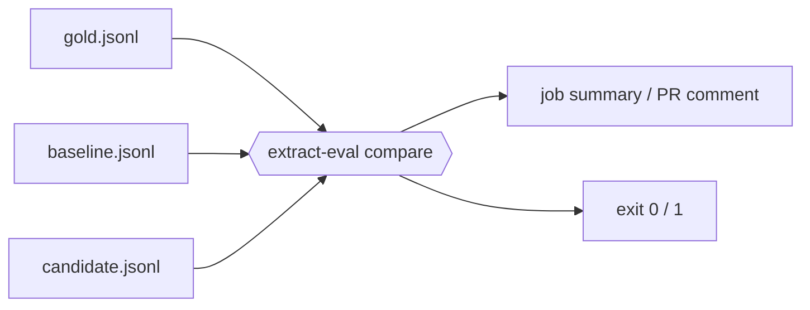

# extract-eval

[](https://github.com/ashiksharonm/extract-eval/actions/workflows/ci.yml)

**Did my extraction change make any field worse?** extract-eval scores structured extraction (LLM, OCR, document-AI) against ground truth, then gates pull requests on regressions: per-field F1 deltas with paired-bootstrap 95% confidence intervals, a markdown job summary, and a non-zero exit when a field significantly regressed. It also handles the fiddly parts of extraction scoring: line items returned in a different order (Hungarian matching), `"$1,234.50"` vs `1234.5`, and dates in different styles.



## Regression gate (GitHub Action)

```yaml
# .github/workflows/extraction-gate.yml
on: pull_request
permissions: {contents: read, pull-requests: write}
jobs:
  gate:
    runs-on: ubuntu-latest
    steps:
      - uses: actions/checkout@v4
      - uses: ashiksharonm/extract-eval@main   # pin a tag or SHA in real use
        with:
          gold: eval/gold.jsonl
          config: eval/extract-eval.yaml
          baseline: eval/baseline_preds.jsonl     # e.g. predictions committed from main
          candidate: eval/candidate_preds.jsonl   # produced earlier in the job
          comment-on-pr: "true"
```

Or locally / in any CI:

```bash
extract-eval compare baseline.jsonl candidate.jsonl --gold gold.jsonl --config cfg.yaml \
    [--min-drop 0.01] [--significance ci|none] [--scope any|micro|fields] [--summary "$GITHUB_STEP_SUMMARY"]
```

A metric regresses when its F1 delta is negative, at least `--min-drop` in size, and (default) the 95% CI of the paired-bootstrap delta lies entirely below zero. Exit codes: 0 pass, 1 regression, 2 bad input. Per-field checks are not corrected for multiple comparisons; use `--min-drop` or `--scope micro` if that matters to you.

Example on the committed CORD-v2 Donut runs below (100 docs, seed 0, 1000 resamples). Truncated to full decode passes (micro F1 +0.151, CI [0.078, 0.234], 3 docs fail to pass). The reverse direction exits 1 with 8 regressions: micro F1 0.876 to 0.726 (delta -0.151, CI [-0.234, -0.078]), plus `menu.nm`, `menu.cnt`, `menu.price`, `sub_total.subtotal_price`, `sub_total.tax_price`, `total.creditcardprice` and `total.total_price`. The repo's own [self-gate workflow](.github/workflows/self-gate.yml) runs both directions.

## Demo

A Gradio app ([`space/`](space)) scores uploaded gold/prediction JSONL and runs the gate. Run it locally with `docker compose up` (http://localhost:7860) or `pip install -e ".[demo]" && python space/app.py`. Hosted copy: deploy steps are in [docs/DESIGN.md](docs/DESIGN.md) and the `deploy-space` workflow; no Space is published yet.

## Features

- Field matchers: `exact`, `text` (normalized), `numeric` (tolerance, currency/thousands parsing, `us`/`eu`/`auto` locales), `date`, `fuzzy` (rapidfuzz).
- Line items are aligned with the Hungarian algorithm (`scipy.optimize.linear_sum_assignment`) before per-field scoring; unmatched gold items count as FN, unmatched predicted items as FP.
- Per-field precision/recall/F1, micro and macro averages, per-document scores, bootstrap 95% CIs over documents.
- Error buckets: `missing`, `extra`, `mismatch`, `format_only` (right value, wrong formatting).
- Run comparison: per-field deltas, paired-bootstrap CI, documents flipping pass/fail.
- YAML config, CLI with markdown reports and `--fail-under`, and `assert_min_scores()` for CI gates.

## Why Hungarian matching matters

Gold has three line items; the model returns the same three in a different order.

```python
from extract_eval import Config, score_document

cfg = Config.from_dict({"line_items": {"items": {"fields": {"name": "text", "price": "numeric"}}}})
gold = {"items": [{"name": "Latte", "price": "4.50"}, {"name": "Tea", "price": "3.00"},
                  {"name": "Cake", "price": "5.00"}]}
pred = {"items": [{"name": "Tea", "price": "3.00"}, {"name": "Cake", "price": "5.00"},
                  {"name": "Latte", "price": "4.50"}]}
score_document("d", gold, pred, cfg).counts
# {'items.name': [3, 0, 0], 'items.price': [3, 0, 0]}   # [TP, FP, FN]: perfect
```

Comparing item *i* with item *i* gets 0 of 6 values right on the same input. Alignment first, scoring second.

## Install

```bash
pip install git+https://github.com/ashiksharonm/extract-eval   # not published to PyPI
```

## Quickstart

```python
from extract_eval import Config, evaluate, assert_min_scores, load_jsonl, compare_reports

cfg = Config.from_yaml("examples/receipts.yaml")
report = evaluate(load_jsonl("examples/gold.jsonl"), load_jsonl("examples/pred.jsonl"), cfg)
print(report["micro"], report["fields"]["total"]["f1"])
assert_min_scores(report, {"micro_f1": 0.8, "total": 1.0})   # raises AssertionError listing failures
```

Records are JSONL, one document per line: `{"id": "r1", "data": {...}}`. A gold document without a prediction is scored as all-missing.

## CLI

```bash
extract-eval score --gold gold.jsonl --pred pred.jsonl --config cfg.yaml \
    --out out/report.json [--markdown out/report.md] [--fail-under 0.9] [--n-boot 1000] [--seed 0]
extract-eval compare out/run_a.json out/run_b.json --out out/cmp.json   # report.json inputs need no --gold
```

`score` writes `report.json` plus a markdown report and exits 1 if micro F1 is below `--fail-under`.

## Config

```yaml
default: text                  # matcher for fields without one
doc_pass_f1: 1.0               # a document "passes" when its F1 >= this
scalars:                       # dotted paths into the document
  total: {type: numeric, abs_tol: 0.005}
  date: {type: date, dayfirst: true}
  vendor: {type: fuzzy, threshold: 0.85}
line_items:
  items:
    match_on: {name: 1.0, price: 0.5}   # fields (with weights) used to align; default: all fields
    min_similarity: 0.3                 # weaker pairs stay unmatched (FN + FP)
    fields:
      name: {type: fuzzy, threshold: 0.85}
      qty: {type: numeric}
      price: {type: numeric, locale: auto}
```

Matcher options: `numeric` takes `abs_tol`, `rel_tol`, `locale` (`us`, `eu`, `auto`); `date` takes `dayfirst`; `fuzzy` takes `threshold` and `scorer` (any rapidfuzz `fuzz` scorer). Missing means `null`, `""` or whitespace; both sides missing is ignored. A wrong value counts as one FP and one FN.

## Benchmark: Donut on CORD-v2

`naver-clova-ix/donut-base-finetuned-cord-v2` on the full CORD-v2 **test split (100 docs)**, greedy decoding, Apple M5 16 GB (MPS), 216 s total (2.16 s/doc). Menu lines are aligned with Hungarian matching; totals are scalars (`benchmarks/cord.yaml`). The weak variant is the same greedy decode cut to the first 96 generated tokens (equivalent to `max_length=96`, since greedy decoding is prefix-consistent).

| run | micro F1 (95% CI) | macro F1 (95% CI) | docs with F1 = 1.0 |
|---|---|---|---|
| Donut, full decode | 0.876 [0.842, 0.908] | 0.859 [0.798, 0.900] | 47% |
| Donut, truncated to 96 tokens | 0.726 [0.644, 0.802] | 0.710 [0.624, 0.785] | 44% |
| delta (paired bootstrap) | +0.151 [0.078, 0.234] | +0.149 [0.080, 0.229] | +3 docs, 0 regressions |

Per-field F1 for the full run: `menu.nm` 0.832, `menu.cnt` 0.943, `menu.price` 0.863, `total.total_price` 0.906, `sub_total.subtotal_price` 0.892. Of 193 errors, 47 missing, 66 extra, 48 mismatch, 32 format-only. Everything is committed under [`benchmarks/cord_v2`](benchmarks/cord_v2) (gold and predictions JSONL, `report_*.json/.md`, `comparison.*`, `run_meta.json`); reproduce with `python benchmarks/run_cord.py` then `benchmarks/score_cord.sh` (needs `torch transformers datasets sentencepiece pillow`).

These numbers are not comparable to the field-level or tree-edit-distance scores in the Donut paper: the schema subset, matchers, and metric here are this repo's own (see `benchmarks/cord.yaml`).

## Limitations

- The gate compares runs on one gold set; it cannot detect distribution shift, and with a small gold set a real regression may not reach significance (use `--significance none` with a `--min-drop` floor).
- Line-item alignment uses only the fields in `match_on`; items identical on those fields are interchangeable, so ties are broken arbitrarily.
- Only scalar fields and one flat level of line items are scored; nested groups (e.g. CORD `sub` items) are ignored.
- Dates without an explicit format are parsed from a fixed list of common formats, with `dayfirst` resolving ambiguity.
- Bootstrap CIs resample documents, so they are wide for small sets and say nothing about distribution shift.
- Numeric parsing is heuristic: choose `locale` deliberately when `.` or `,` could be either separator.
- The format-only bucket is a heuristic (equal after text normalization, number parsing in either locale, or date parsing).

## Development

```bash
uv venv --python 3.11 && uv pip install -e ".[dev,demo]"
ruff check . && mypy && pytest -q    # coverage gate: 85%
```

Design notes: [docs/DESIGN.md](docs/DESIGN.md). Changes: [CHANGELOG.md](CHANGELOG.md). MIT licensed.
