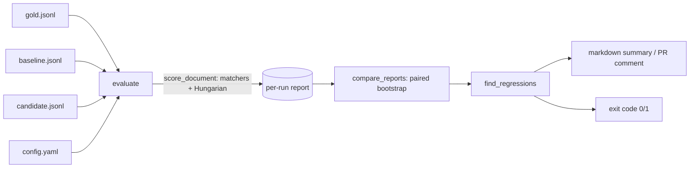
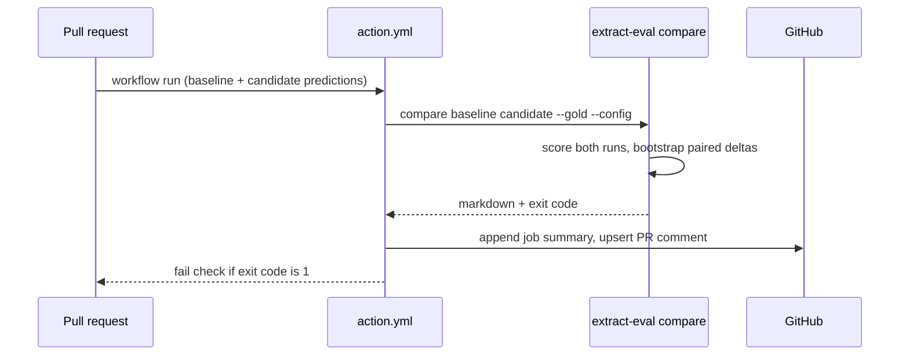

# extract-eval design

## Problem
Teams change an extraction pipeline (new prompt, model, OCR engine) and need to know whether any field got worse. A single aggregate F1 hides per-field regressions, line-item ordering breaks naive comparison, and with 100-ish documents a 1-point change is noise. extract-eval scores extraction output fairly and decides, with confidence intervals, whether a candidate run regressed against a baseline, as a CI check.

## Requirements
Functional
- Score predictions against gold: field matchers, Hungarian line-item alignment, per-field P/R/F1, micro/macro, error buckets.
- Compare baseline and candidate on the same gold set: per-field F1 deltas with paired-bootstrap 95% CIs, pass/fail flips.
- Flag significant regressions; exit non-zero; emit markdown for `$GITHUB_STEP_SUMMARY` and PR comments.
- Usable as Python library, CLI, GitHub Action, and a small web demo.

Non-functional
- Deterministic (seeded bootstrap); no network, no model downloads; runs in seconds for thousands of documents (bootstrap is chunked to bound memory).
- Python 3.10-3.13, typed (`py.typed`, mypy clean), >= 85% coverage enforced in CI.
- Inputs are untrusted files: only `json.loads` / `yaml.safe_load`; no code execution.

## Architecture

## Data model
- Record: `{"id": str, "data": {...}}` per JSONL line (or fields beside `id`).
- Report: `micro`, `macro`, `fields{name: tp/fp/fn/precision/recall/f1/f1_ci95/errors}`, `docs{id: counts, passed}`, `errors[]`.
- Comparison: `micro_f1|macro_f1|pass_rate{a,b,delta,delta_ci95}`, `fields{name: {a,b,delta,delta_ci95}}`, `flips`, `regressions[]`.

## CLI / action contract
`extract-eval compare BASELINE CANDIDATE [--gold G --config C] [--min-drop X] [--significance ci|none] [--scope any|micro|fields] [--summary FILE] [--gate-markdown FILE] [--out FILE]`
Exit codes: 0 no regression, 1 regression, 2 usage or input error. BASELINE/CANDIDATE are prediction JSONL (needs `--gold`, `--config`) or `report.json` files from `extract-eval score`. The action wraps this with inputs `gold, config, baseline, candidate, min-drop, significance, scope, n-boot, comment-on-pr` and output `regressed`.

Regression rule: a metric regresses when `delta <= -min_drop` and, with `significance=ci`, the 95% CI of the paired-bootstrap delta lies entirely below zero.

## Scaling path
Scoring is O(docs x items^2) for the assignment step and the bootstrap is O(n_boot x docs x fields), chunked 100 resamples at a time. For very large sets: reduce `--n-boot`, shard docs by id and merge counts (counts are additive), or cache per-run reports and compare reports directly.

## Failure modes and mitigations
| failure | mitigation |
|---|---|
| Baseline and candidate cover different ids | Scored against gold; missing predictions count as all-missing and are reported (`n_missing_predictions`) |
| Tiny gold set, wide CIs | Gate stays quiet unless the CI excludes zero; `--significance none` for strict mode |
| Many fields, chance false positives | Documented: no multiple-comparison correction; use `--min-drop` or `--scope micro` |
| Malformed input | Exit 2 with a one-line error, no stack trace |
| PR comment token lacks permission | Comment step degrades to a notice; job summary and exit code still apply |

## Security and privacy
Reads local files only. The demo processes uploads in memory (5 MB cap) and stores nothing. The action pins no secrets; the default `GITHUB_TOKEN` is used only for the comment. Containers run as a non-root user.

## Decisions
- ADR-1 Paired bootstrap over documents (not McNemar/t-test): works for any ratio metric incl. micro F1, no distribution assumption. Cost: resampling time.
- ADR-2 Gate on CI excluding zero rather than a fixed threshold: adapts to set size. `--min-drop` adds a practical-significance floor.
- ADR-3 Score both runs inside the gate (instead of requiring reports): one command in CI. Report inputs remain supported.
- ADR-4 Hatch with a single-source version in `__init__.py`; releases attach artifacts to GitHub, PyPI publication is a manual owner decision.

## Cost (free tier)
| component | service | cost |
|---|---|---|
| CI, CodeQL, release artifacts | GitHub Actions | free for public repos |
| Demo | Hugging Face Space (CPU basic, Gradio) | free |
| Container image | built in CI, local compose | free |
